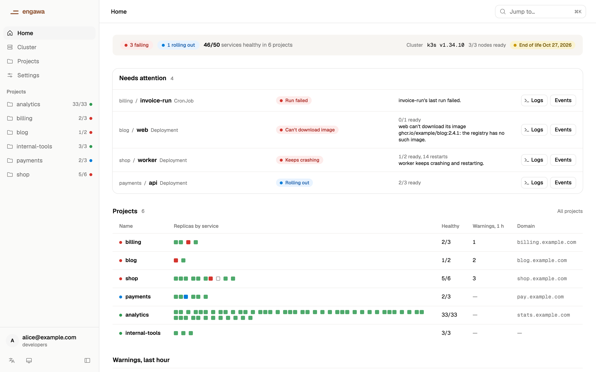
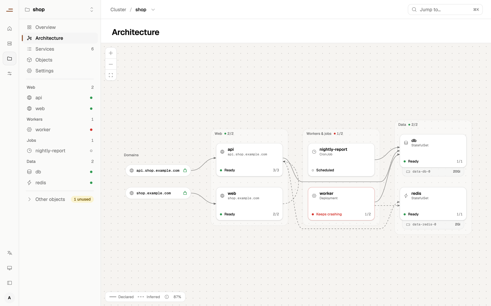
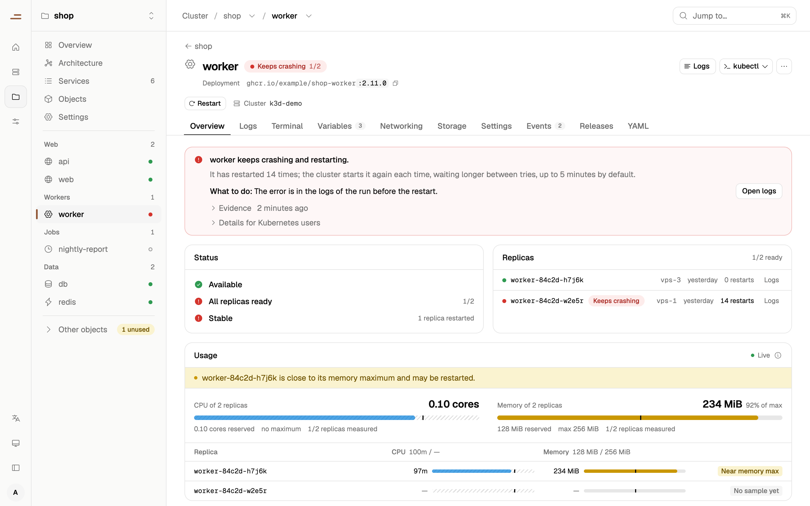
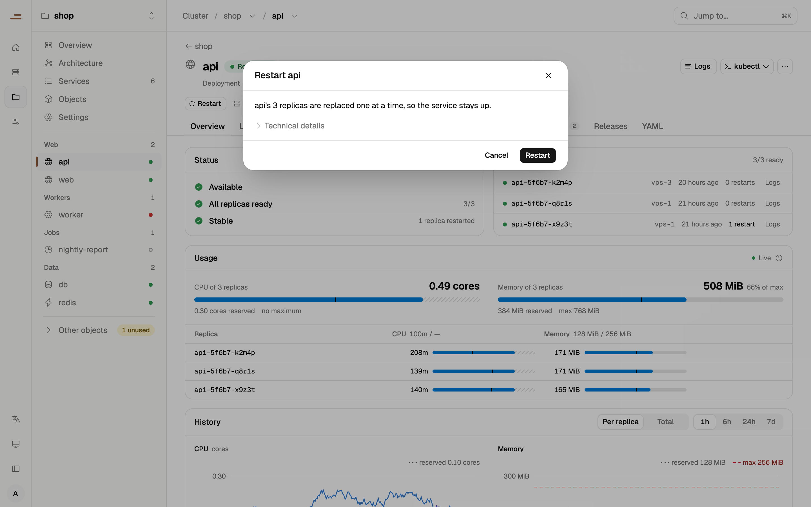

# Engawa

**Kubernetes made simple and secure by default.**

Engawa (縁側, the veranda of a Japanese house: open to the garden, under the same roof) shows a
cluster as projects and services, explains what is wrong in plain words, and lets you change
things safely. It works with the objects you already have, never acts with more rights than you
have, and keeps no state of its own.

> **Status: pre-alpha (0.0.1).** It works end to end, on your machine and in a cluster, but
> there are no published images or binaries yet, the API may still change, and it has been tried
> on few clusters. Do not point it at a cluster you cannot afford to break.

<p align="center">
  
</p>

| | |
| --- | --- |
|  |  |
| **Architecture** of a project, from the objects it has. | **Diagnoses** in plain words, with the fix and the evidence. |
|  | |
| **Every change is a plan** you confirm; the details are one click away. | |

<sub>Screenshots of the built-in demo data (`cargo run -p engawa-api --example demo`).</sub>

## Principles

- **Your rights, not Engawa's.** Every request is made with your own credential (a token from
  [Genkan](https://github.com/engawahq/genkan), or your kubeconfig on your machine);
  kube-apiserver decides. In a cluster, admin rights are asked for only when your everyday ones
  are refused; they need your passkey again and last a few minutes.
- **Kubernetes objects are the only state.** No database and no custom resources: a project is
  a namespace. Remove Engawa and the cluster is as it was.
- **Works with Helm, Argo CD and Flux.** Objects they manage are shown as such; Engawa does not
  fight them for fields.
- **Suggests, does not install.** Missing pieces come with a `helm` command, a Flux
  `HelmRelease`, an Argo CD `Application` or a k3s `HelmChart`.
- **Light.** One static binary, small enough to run next to k3s on a 2 GB machine.

## What works today

- **Projects and services.** Namespaces shown as projects, and their workloads, Services,
  routes, ConfigMaps, Secrets and volumes grouped into services, with what Helm, Argo CD or Flux
  manages marked as such. The cluster page shows the nodes, how long the Kubernetes version is
  supported, upgrades, and which recommended components are installed.
- **Diagnoses in plain words.** Why a service is unhealthy (a crash loop, out of memory, an image
  that cannot be pulled, a failing probe, traffic that cannot reach it, a quota, no node with
  room, missing configuration), with the fix and the status fields and events it rests on; and
  what a project is missing (resource requests and limits, readiness probes, Ingresses that can
  move to Gateway API). A refusal by RBAC is told apart from a component that is not installed.
- **Changes as plan, confirm, apply.** Environment variables, ConfigMap and Secret keys,
  hostnames, restarts, scaling, probes, resources, volumes and mounts, an object's YAML,
  deleting an object, ready-made NetworkPolicies, adopting a namespace as a project and its
  details. A plan shows the fields it writes and who owns them now; the apply writes only those
  fields, and is refused if anything changed since the plan.
- **Releases and rollback** of a workload's pod template, through the same plans.
- **Logs and a terminal**: a pod's logs, followed live, and a shell in a container.
- **Usage**: CPU and memory now (metrics-server) and their history (a Prometheus-compatible
  store such as VictoriaMetrics).
- **Suggested installs** for missing components, as a `helm` command, a Flux `HelmRelease`, an
  Argo CD `Application` or a k3s `HelmChart`, from the
  [recommendations](https://github.com/engawahq/recommendations) catalogue.
- **In a cluster**, with its Helm chart: sign-in through Genkan with a passkey, admin rights
  confirmed with the passkey again, and nothing left behind after uninstalling.
- **`engawactl mcp`**: a read-only [Model Context Protocol](https://modelcontextprotocol.io)
  server over stdio, so an AI assistant can ask what is failing and why, with your rights and
  never a Secret's value.
- **`engawactl doctor`**: checks the cluster version, the Genkan setup and the recommended
  components, as text or JSON, with an exit code for scripts.

Not yet: published container images and release binaries, creating new workloads, editing or
deleting objects that Helm, Argo CD or Flux manage (they can be restarted), more than one
replica in a cluster, and signing in without Genkan.

## Quick start

On your machine, with your kubeconfig. Build from source in the [Nix](https://nixos.org) dev
shell, which provides every tool:

```sh
git clone https://github.com/engawahq/engawa && cd engawa
nix develop
./scripts/build-ui.sh
ENGAWA_UI_DIST="$PWD/web/dist" cargo build --release --locked -p engawactl
./target/release/engawactl ui                  # --context <name> for another context
```

`engawactl ui` listens on a random loopback port, opens the browser, and makes every request
with your current kubeconfig context. `engawactl doctor` and `engawactl mcp` use it the same way.

In a cluster, for everyone who signs in through Genkan: [Install in a cluster](docs/install.md).

## Learn more

- [Install in a cluster](docs/install.md): the Helm chart, signing in through Genkan.
- [Architecture](docs/architecture.md): principles, layers, crates.
- [Contributing](CONTRIBUTING.md): environment, checks, dependency policy, tests.
- [Testing](docs/testing.md): what is tested at which level, and what is not.

## Licence and credits

Apache-2.0. Contributions are accepted under the [Developer Certificate of Origin](DCO).

Third-party content in this repository:

- [shadcn/ui](https://ui.shadcn.com) components (`web/src/components/ui`), theme
  (`web/src/styles/shadcn/theme.css`) and base styles (MIT, notice in
  `web/src/styles/genkan/shadcn.css`).
- The [Geist](https://github.com/vercel/geist-font) font (SIL Open Font License 1.1,
  `web/src/styles/genkan/LICENSE-Geist.txt`). It and the base styles are copied from
  [Genkan](https://github.com/engawahq/genkan) (Apache-2.0) at the commit in
  `web/src/styles/genkan/VENDORED`.
- Geist Mono from Vercel's release (SIL Open Font License 1.1,
  `web/src/styles/geist-mono/LICENSE-GeistMono.txt`).
- The [recommendations](https://github.com/engawahq/recommendations) catalogue in
  `crates/engawa-recommend/bundle` (Apache-2.0, `bundle/LICENSE`).
- Kubernetes' release schedule in `crates/engawa-recommend/src/versions.rs`, from
  [kubernetes/website](https://github.com/kubernetes/website) `data/releases` (CC BY 4.0, The
  Kubernetes Authors).
- Rendered manifests of upstream Helm charts in `fixtures/charts`, test input only, each under
  its chart's licence (Apache-2.0 or MIT; listed in `fixtures/charts/README.md`).

The container image includes Mozilla's CA certificate bundle as packaged by nixpkgs (MPL-2.0).
