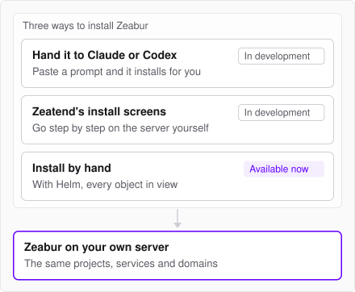

All three ways give you the same Zeabur. They differ in who does the work and how much of it you see.

| If | Pick | Available |
| --- | --- | --- |
| You want an AI assistant to do it | [Let an agent install or migrate for you](../install/agent.mdx) | In development |
| You prefer to work on the server yourself | [One-command install with Zeatend](../install/one-command.mdx) | In development |
| You run a cluster and want to see every object | [Install Zeabur in an existing cluster by hand](../install/existing-cluster.mdx) | Yes |

Today you install by hand. Helm, Kubernetes' install tool, puts Zeabur into a Kubernetes cluster you already have. Kubernetes is open-source software that runs containers on one or more servers, and a cluster is a group of servers it manages.

When the other two ways are ready, this table will say so. To follow them, watch [#430](https://github.com/zeabur-oss/zeabur/issues/430) and [#544](https://github.com/zeabur-oss/zeabur/issues/544).

To look at a cluster from your own computer without installing anything in it, see [Zeabur Desktop](../install/desktop.mdx).
