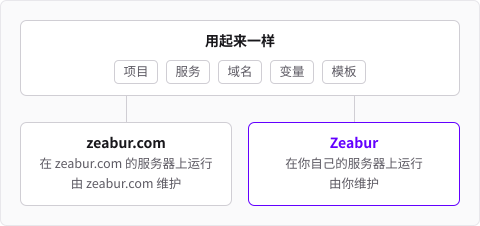

用过 zeabur.com，现在想把服务放到自己的服务器上？读完这一页，你会知道 Zeabur 哪些用起来和 zeabur.com 一样，哪些需要自己负责，以及从哪一页开始。

## 用起来一样的地方

| 你在 zeabur.com 做的事 | 在 Zeabur 怎么做 |
| --- | --- |
| 创建项目，把相关的服务放在一起 | [创建和管理项目](../configure/projects.mdx) |
| 从 Git 仓库部署 | [从 Git 构建并部署服务](../deploy/git.mdx) |
| 部署 Docker 镜像 | [部署容器镜像](../deploy/image.mdx) |
| 导入 Docker Compose | [导入 Docker Compose 服务](../deploy/compose.mdx) |
| 上传文件夹部署 | [上传文件夹并部署服务](../deploy/upload.mdx) |
| 从模板一键部署 | [从应用模板部署](../deploy/templates.mdx) |
| 创建数据库 | [创建、备份与还原数据库](../deploy/databases.mdx) |
| 给服务添加域名 | [添加公开域名与 HTTPS](../configure/domains.mdx) |
| 配置环境变量 | [配置环境变量](../configure/variables.mdx) |
| 查看日志、重启、回到上一个版本 | [查看日志、事件和用量](../configure/logs-terminal.mdx)、[重启、回滚与暂停服务](../configure/restart-rollback.mdx) |

zeabur.com 上常用的模板在 Zeabur Catalog 里对应哪些模板，见 [Zeabur 模板对照表](https://github.com/zeabur-oss/catalog/blob/main/docs/zh-CN/get-started/zeabur-com-templates.mdx)。

## 不一样的地方

- **服务器是你的**：Zeabur 装在你自己的服务器上。服务在哪里运行、用多大的服务器，都由你决定。
- **费用付给服务器提供商**：Zeabur 是开源软件，不向你收费，也没有按用量计费。你只需把服务器的费用付给你选的云厂商或机房。
- **由你维护**：[升级 Zeabur](../upgrade/steps.mdx)、[备份集群](../cluster/backups.mdx)和维护服务器，都由你或你的团队负责。
- **成员由你邀请**：每个人用自己的通行密钥登录，只能使用你分给他的项目。见[邀请成员并分配项目权限](../cluster/members.mdx)。
- **项目不会自动迁移过来**：在 Zeabur 用同一个 Git 仓库、镜像或模板重新部署服务。变量要重新设置，数据库和磁盘里的数据要自己复制过来。最后把域名指向新的地址。

## 从哪里开始

Zeabur 装在 Kubernetes 上。Kubernetes 是在一台或多台服务器上运行容器的开源系统。有哪些安装方式、哪一种适合你，见[在一台服务器上安装 Zeabur](quickstart.mdx)。装好后，再[部署第一个服务](first-project.mdx)。
