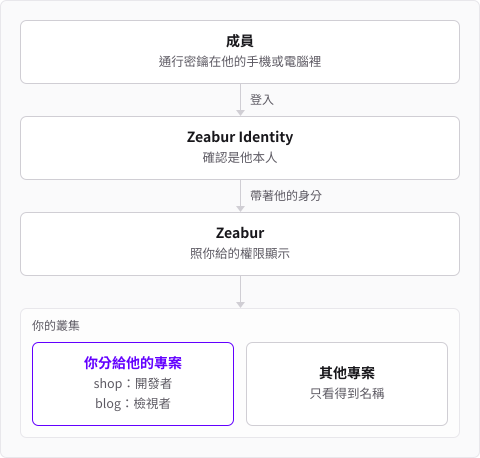

照這一頁做完，你的同事會出現在**成員**頁，用自己的通行密鑰登入 Zeabur，只能用你分給他的專案。通行密鑰存在對方的手機或電腦裡，用指紋、臉部辨識或螢幕鎖解鎖，不用記密碼。



## 開始之前

- 你用管理員帳號登入 Zeabur。
- 叢集裝了 Zeabur Identity，負責 Zeabur 的登入。它要以 `--invitations` 執行，設定連結才能用。
- 安裝 Zeabur 時沒有關掉 Chart 的 `memberRoles.enabled`（預設開啟）。關掉時，邀請只能選要不要給**管理員**。

## 邀請一位成員

<Steps>
<Step>

### 填入帳號

打開**成員**，按**邀請**。填入**使用者名稱**。**顯示名稱**可以不填。

使用者名稱只能用小寫字母、數字、`-` 和 `.`，最多 63 個字元。填的是既有成員時，連結會替他多加一把通行密鑰，權限不變。

只想把人加進一個專案，也可以從那個專案開始：打開專案的**設定**，在**成員**的**邀請別人加入這個專案**旁按**邀請**。這個專案會先勾好，角色是開發者。

</Step>
<Step>

### 選擇他能用的專案

在**權限**選**指定專案**，勾選專案，再為每個專案選角色。剛勾選的專案是**檢視者**。

| 角色 | 能做什麼 |
| --- | --- |
| **開發者** | 部署、修改變數、重新啟動、看日誌、開終端機，也能看機密變數的值。 |
| **檢視者** | 看狀態和事件。不能看日誌、不能修改、不能開終端機，也不能看機密變數的值。 |

同一個人可以在不同專案擔任不同角色。一個專案都沒勾的人也能登入，但只看得到節點和專案名稱。


選**管理員**，對方就能完整控制整個叢集，包括所有專案、節點和成員。管理員只能用通行密鑰登入，不能用 GitHub 或 Google，見[管理員帳號和一般帳號](../reference/permissions.mdx#管理員帳號和一般帳號)。

清單只列出專案。叢集裡還有其他 Namespace 時，按清單下方的**一併顯示 N 個不是專案的 Namespace**。Namespace 是 Kubernetes 用來分組的單位，每個專案就是一個 Namespace。

</Step>
<Step>

### 檢查變更

按**檢查變更**。畫面會列出要新增的帳號和每個專案的權限。確認沒問題，按**邀請 erin**（`erin` 是使用者名稱）。


</Step>
<Step>

### 把連結傳給對方

複製畫面上的設定連結，用只有對方收得到的管道傳過去。


連結 7 天內有效，只能用一次。完整連結只顯示這一次。

</Step>
<Step>

### 確認他能登入

對方打開連結，新增通行密鑰。回到**成員**，他那一列的**通行密鑰**欄會出現數字。接著請他登入，打開你分給他的專案。


</Step>
</Steps>

<Callout type="warn">
誰先打開設定連結，誰就能替這個帳號加通行密鑰並登入。連結送錯人或外流時，到**待使用的設定連結**按**撤銷**，再產生新的連結。
</Callout>

## 變更權限

在成員那一列按 **⋯**，選**變更權限**。調整專案和角色，按**檢查變更**，再按**儲存權限**。

權限馬上生效。對方已經開著的終端機，會維持到關掉為止。

把成員改成**管理員**後，他只能用通行密鑰登入。他用 GitHub 或 Google 登入的工作階段會結束。拿掉**管理員**，帳號就改回一般帳號。

## 多加一台裝置，或處理遺失的裝置

要替成員多加一台備用裝置，在他那一列按 **⋯**，選**新的設定連結**。這個連結 24 小時內有效，只能用一次。原本的通行密鑰和工作階段都會保留。

裝置遺失或被偷時，按 **⋯**，選**遺失裝置後重設**。勾選**同時移除他的通行密鑰、連結的帳號和工作階段（裝置遺失或遭竊時）**，再按**重設並產生連結**。在對方打開新連結之前，沒有人能用這個帳號登入。


## 移除成員

先到**待使用的設定連結**，撤銷還沒用到的連結。接著在成員那一列按 **⋯**，選**移除成員**，確認後移除。

移除會刪掉他的通行密鑰、連結的帳號、工作階段、設定連結，以及 Zeabur 替他建立的權限。專案和服務都會留著。

## 遇到問題

| 看到的狀況 | 怎麼處理 |
| --- | --- |
| **沒有安裝 Zeabur Identity** | 請叢集管理員安裝 Zeabur Identity，或在啟動 Zeabur 時指定 Zeabur Identity 所在的 Namespace。 |
| 畫面說 Zeabur 不知道 Zeabur Identity 的網址 | 以 `--issuer-url` 啟動 Zeabur。 |
| 畫面說 Zeabur Identity 目前不接受設定連結 | 以 `--invitations` 執行 Zeabur Identity。 |
| **安裝 Zeabur 時沒有啟用成員角色** | 用 `memberRoles.enabled=true` 升級 Chart，或把這位成員設為管理員。完整的權限對照見[權限](../reference/permissions.mdx)。 |
| 不能變更自己的權限、重設或移除自己 | 請另一位管理員處理。自己的備用通行密鑰可以從帳號頁新增。 |
| 畫面說變更已過期 | 重新按**檢查變更**。 |
| 對方登入後看不到專案 | 在**成員**確認他那一列列出了專案和角色。沒有的話，用**變更權限**加上。 |

## 用 kubectl 做同樣的事

成員是 Zeabur Identity 的 `User`，放在 `zeabur-identity` Namespace。權限是一般的角色綁定，名稱都是 `zeabur-member-<使用者名稱>`：一個 ClusterRoleBinding 綁到 `zeabur-member`，讓他能登入並看到節點和專案名稱；每個分到的專案再一個 RoleBinding，綁到 `zeabur-project-developer` 或 `zeabur-project-viewer`。Kubernetes 看到的使用者名稱是 `zeabur:<使用者名稱>`。

下面讓 `erin` 成為一般帳號，在 `shop` 擔任開發者：

```yaml
apiVersion: identity.zeabur.com/v1alpha1
kind: User
metadata:
  name: erin
  namespace: zeabur-identity
  labels:
    app.kubernetes.io/managed-by: zeabur
spec:
  username: erin
  displayName: Erin Lin
  groups: []
  accountType: Regular
---
apiVersion: rbac.authorization.k8s.io/v1
kind: ClusterRoleBinding
metadata:
  name: zeabur-member-erin
  labels:
    app.kubernetes.io/managed-by: zeabur
    zeabur.com/member: erin
roleRef:
  apiGroup: rbac.authorization.k8s.io
  kind: ClusterRole
  name: zeabur-member
subjects:
  - apiGroup: rbac.authorization.k8s.io
    kind: User
    name: zeabur:erin
---
apiVersion: rbac.authorization.k8s.io/v1
kind: RoleBinding
metadata:
  name: zeabur-member-erin
  namespace: shop
  labels:
    app.kubernetes.io/managed-by: zeabur
    zeabur.com/member: erin
roleRef:
  apiGroup: rbac.authorization.k8s.io
  kind: ClusterRole
  name: zeabur-project-developer
subjects:
  - apiGroup: rbac.authorization.k8s.io
    kind: User
    name: zeabur:erin
```

要給管理員，把 `accountType` 改成 `Admin`，不用另外綁角色。`groups` 不能寫 `admins`，這個群組只從帳號類型來。

套用後，用 `zeabur-identityctl invite` 產生設定連結，傳給對方：

```sh
zeabur-identityctl invite --username erin
```

改權限就改 RoleBinding 的 `roleRef`（`roleRef` 不能修改，要刪掉重建），或在其他專案建立同樣的 RoleBinding。移除成員時，先刪角色綁定，再刪他的設定連結、通行密鑰和工作階段，最後刪 `User`：

```sh
kubectl delete clusterrolebinding,rolebinding -A -l zeabur.com/member=erin
kubectl -n zeabur-identity delete zbinvite,zbcred,zbgrant -l identity.zeabur.com/user=erin
kubectl -n zeabur-identity delete zbuser erin
```

其他做法，例如用群組授權、停用帳號，見 Zeabur Identity 的[管理使用者](https://oss.zeabur.com/docs/identity/managing-users)。

用 kubectl 確認：

- `kubectl get clusterrolebinding,rolebinding -A -l zeabur.com/member=erin` 列出一個 ClusterRoleBinding，以及每個專案一個 RoleBinding。
- 對方登入後，在他的電腦執行 `kubectl auth whoami`，使用者名稱是 `zeabur:erin`。
- 管理員可以執行 `kubectl auth can-i --as zeabur:erin -n shop create deployments` 檢查。開發者會印出 `yes`，檢視者會印出 `no`。

移除成員時，不是 Zeabur 建立、但指名 `zeabur:<使用者名稱>` 的角色綁定會留著，要由管理員另外檢查。
