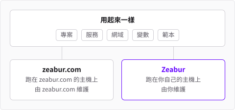

用過 zeabur.com，現在想把服務放到自己的主機上？讀完這一頁，你會知道 Zeabur 哪些用起來和 zeabur.com 一樣，哪些要自己負責，以及從哪一頁開始。

## 用起來一樣的地方

| 你在 zeabur.com 做的事 | 在 Zeabur 怎麼做 |
| --- | --- |
| 建立專案，把相關的服務放在一起 | [建立與管理專案](../configure/projects.mdx) |
| 從 Git 儲存庫部署 | [從 Git 建置並部署服務](../deploy/git.mdx) |
| 部署 Docker 映像檔 | [部署容器映像檔](../deploy/image.mdx) |
| 匯入 Docker Compose | [匯入 Docker Compose 服務](../deploy/compose.mdx) |
| 上傳資料夾部署 | [上傳資料夾並部署服務](../deploy/upload.mdx) |
| 從範本一鍵部署 | [從應用程式範本部署](../deploy/templates.mdx) |
| 建立資料庫 | [建立、備份與還原資料庫](../deploy/databases.mdx) |
| 幫服務加上網域 | [加上公開網域與 HTTPS](../configure/domains.mdx) |
| 設定環境變數 | [設定環境變數](../configure/variables.mdx) |
| 看日誌、重新啟動、回到上一版 | [查看日誌、事件與用量](../configure/logs-terminal.mdx)、[重新啟動、回滾與暫停服務](../configure/restart-rollback.mdx) |

zeabur.com 上常用的範本，在 Zeabur Catalog 裡有哪些對應的範本，見 [Zeabur 範本對照表](https://github.com/zeabur-oss/catalog/blob/main/docs/zh-TW/get-started/zeabur-com-templates.mdx)。

## 不一樣的地方

- **主機是你的**：Zeabur 裝在你自己的主機上。服務跑在哪裡、用多大的主機，都由你決定。
- **費用付給主機的供應商**：Zeabur 是開源軟體，不向你收費，也沒有用量計費。你只付主機的費用給你選的雲端服務或機房。
- **由你維護**：[升級 Zeabur](../upgrade/steps.mdx)、[備份叢集](../cluster/backups.mdx)和照顧主機，都由你或你的團隊負責。
- **成員由你邀請**：每個人用自己的通行密鑰登入，只能用你分給他的專案。見[邀請成員並分配專案權限](../cluster/members.mdx)。
- **專案不會自動搬過來**：在 Zeabur 用同一個 Git 儲存庫、映像檔或範本重新部署服務。變數要重新設定，資料庫和磁碟裡的資料要自己複製過來。最後把網域指到新的位址。

## 從哪裡開始

Zeabur 裝在 Kubernetes 上。Kubernetes 是在一台或多台主機上執行容器的開源系統。有哪些安裝方式、哪一種適合你，見[在一台伺服器安裝 Zeabur](quickstart.mdx)。裝好後，再[部署第一個服務](first-project.mdx)。
